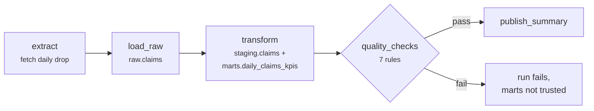

# Airflow ELT Pipeline

[](https://github.com/mprantikk/airflow-elt-pipeline/actions/workflows/ci.yml)


A production-style daily ELT pipeline in Apache Airflow: it pulls a claims file, lands it raw in Postgres, cleans it into staging, refreshes a KPI mart, and **blocks the run if any data-quality check fails**. All data is synthetic.

## The DAG



| Task | What it does |
|---|---|
| `extract` | Fetches the day's claims drop. Synthetic and deterministic per date here; an SFTP pull or EHR export API in production |
| `load_raw` | Lands the file untouched (all text) in `raw.claims`, delete-then-insert per load date |
| `transform` | Deduplicates re-sent rows, rejects rows with no payer, strips currency formatting, standardises statuses, types everything into `staging.claims`, and upserts one row into `marts.daily_claims_kpis` |
| `quality_checks` | 7 SQL rules: rows loaded, no duplicate claims, valid statuses, positive amounts, no future service dates, staging reconciles to raw, KPI row present. Any failure raises and fails the run |
| `publish_summary` | Logs the day's KPIs (swap in Slack or email) |

## Engineering choices

- **Idempotent by design.** Every task can re-run for the same date and produce the same result, so retries and `airflow dags backfill` are safe. A test proves it.
- **Logic outside the DAG.** Task code lives in `elt/` as plain functions; the DAG only wires them together. That keeps it testable without a scheduler and keeps DAG parsing fast.
- **Raw, staging, marts.** Raw keeps exactly what arrived for audit and replay; cleaning happens in SQL in the warehouse (ELT, not ETL).
- **Fail loudly.** Retries with delay, an execution timeout on every task, `max_active_runs=1`, and a data-quality gate before anything is published.

## Run it

```bash
git clone https://github.com/mprantikk/airflow-elt-pipeline.git
cd airflow-elt-pipeline
docker compose up -d
# Airflow UI: http://localhost:8080 (user "admin", password in: docker compose logs airflow | grep Password)
```

Trigger `claims_daily_elt` from the UI, or run one day from the command line:

```bash
docker compose exec airflow airflow dags test claims_daily_elt 2025-12-05
```

```
2025-12-05: 203 claims, $103431.94 billed, denial rate 18.9%, 2 rows rejected, 7 checks passed
```

## Tests and CI

- **DAG integrity:** the DAG imports with no errors, tasks run in the expected order, every task has retries and a timeout.
- **End to end:** three days through extract → load → transform → checks against a real Postgres; re-running a day leaves row counts unchanged; corrupting a row makes the quality gate raise.
- **GitHub Actions** installs Airflow with the official constraints file, runs the tests against a Postgres service, then runs the full DAG for one day with `airflow dags test`.

## Layout

```
├── dags/claims_elt_dag.py   TaskFlow DAG (wiring only)
├── elt/                     source, load, transform, checks, db helpers
├── sql/                     schema.sql, transform.sql
├── tests/                   DAG integrity + end-to-end tests
└── docker-compose.yml       Postgres warehouse + Airflow standalone
```

Built by [Masud Parvej](https://mprantikk.github.io/).
